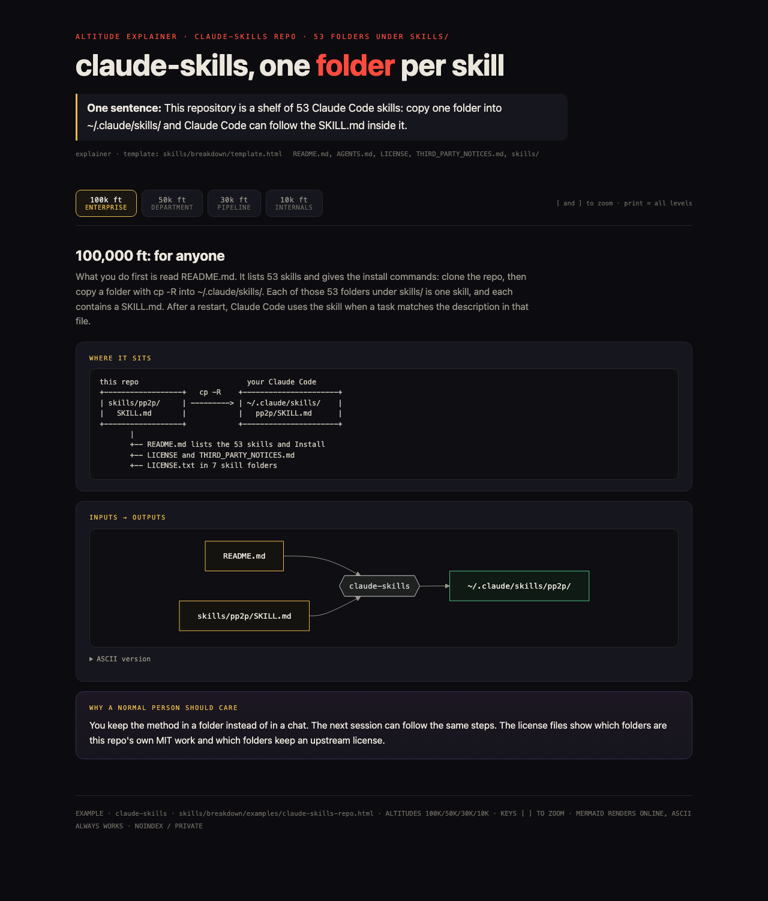

# breakdown

breakdown explains a body of work at four altitudes, 100,000, 50,000, 30,000, and 10,000 feet, and it puts one plain sentence first. When the explanation is substantial, it copies template.html, fills every placeholder, and saves one zoomable HTML page.

## Install

```bash
git clone https://github.com/LucasCooperBey/claude-skills.git
cp -R claude-skills/skills/breakdown ~/.claude/skills/
```

## Quick start

Type `/breakdown` after finishing a piece of work, or `/breakdown <a repo, folder or concept>`. What comes back is one plain sentence, the four altitudes, where the work sits, a short backstory, the gaps, and, for a substantial explanation, the HTML page.

## Example

The filled page [examples/claude-skills-repo.html](examples/claude-skills-repo.html) explains the claude-skills repository: the 53 skill folders, how a skill is laid out, how the README install commands work, where credits and licenses live, and what a reader does first.

GitHub shows the HTML file as source, so open it from your clone in a browser (on macOS: `open claude-skills/skills/breakdown/examples/claude-skills-repo.html`). Its first screen, the 100,000 ft level:



One sentence from the page:

> This repository is a shelf of 53 Claude Code skills: copy one folder into ~/.claude/skills/ and Claude Code can follow the SKILL.md inside it.

100,000 ft section from the page:

> 100,000 ft: for anyone

> What you do first is read README.md. It lists 53 skills and gives the install commands: clone the repo, then copy a folder with cp -R into ~/.claude/skills/. Each of those 53 folders under skills/ is one skill, and each contains a SKILL.md. After a restart, Claude Code uses the skill when a task matches the description in that file.

```
this repo                         your Claude Code
+------------------+   cp -R    +----------------------+
| skills/pp2p/     | ---------> | ~/.claude/skills/    |
|   SKILL.md       |            |   pp2p/SKILL.md      |
+------------------+            +----------------------+
       |
       +-- README.md lists the 53 skills and Install
       +-- LICENSE and THIRD_PARTY_NOTICES.md
       +-- LICENSE.txt in 7 skill folders
```

> You keep the method in a folder instead of in a chat. The next session can follow the same steps. The license files show which folders are this repo's own MIT work and which folders keep an upstream license.

## Needs

Claude Code. A browser to open the page. Network only for the Mermaid diagrams.
