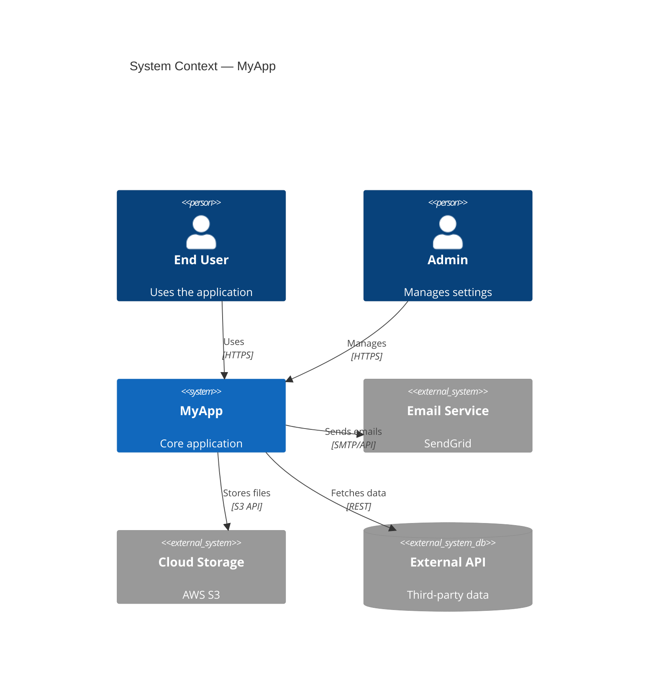
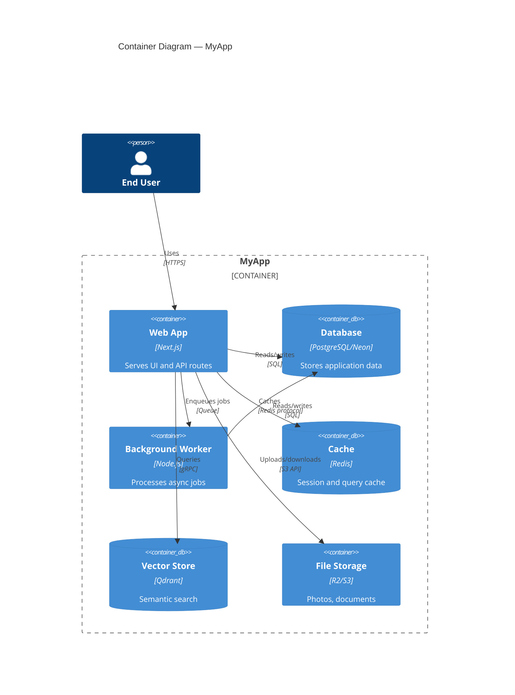

# Mermaid C4 Syntax Reference

## C1 — Context Diagram



## C2 — Container Diagram



## C3 — Component Diagram

```mermaid
C4Component
  title Component Diagram — Web App

  Container_Boundary(web, "Web App") {
    Component(routes, "API Routes", "Next.js API", "REST endpoints")
    Component(auth, "Auth Module", "NextAuth", "Authentication & sessions")
    Component(services, "Service Layer", "TypeScript", "Business logic")
    Component(repo, "Data Access", "Drizzle ORM", "DB queries")
    Component(ai, "AI Pipeline", "Claude/OpenAI", "LLM processing")
    Component(queue, "Job Queue", "BullMQ", "Async task dispatch")
  }

  Rel(routes, auth, "Validates")
  Rel(routes, services, "Delegates to")
  Rel(services, repo, "Queries via")
  Rel(services, ai, "Calls")
  Rel(services, queue, "Enqueues")
  Rel(repo, db, "SQL", "Drizzle")
```

## Conventions

### Node types

| Function | Use for |
|----------|---------|
| `Person(id, label, desc)` | Human actors |
| `System(id, label, desc)` | Your system (C1) |
| `System_Ext(id, label, desc)` | External systems |
| `Container(id, label, tech, desc)` | Apps, services |
| `ContainerDb(id, label, tech, desc)` | Databases, stores |
| `Component(id, label, tech, desc)` | Internal modules |
| `Container_Boundary(id, label)` | Group containers |

### Relationships

```
Rel(from, to, "label")
Rel(from, to, "label", "protocol")
BiRel(a, b, "label")  # bidirectional
```

### Styling tips

- Keep descriptions under 30 chars
- Use tech field for framework/language
- Max 15 nodes per diagram — split if needed
- Group related items with `_Boundary`

### Manual annotations (preserved on refresh)

```mermaid
%% MANUAL: This relationship is planned but not yet implemented
Rel(web, ml, "Will call", "gRPC")
```

Lines starting with `%% MANUAL:` are preserved across regeneration.
Lines starting with `%% UNCERTAIN:` flag relationships the tool couldn't verify.
