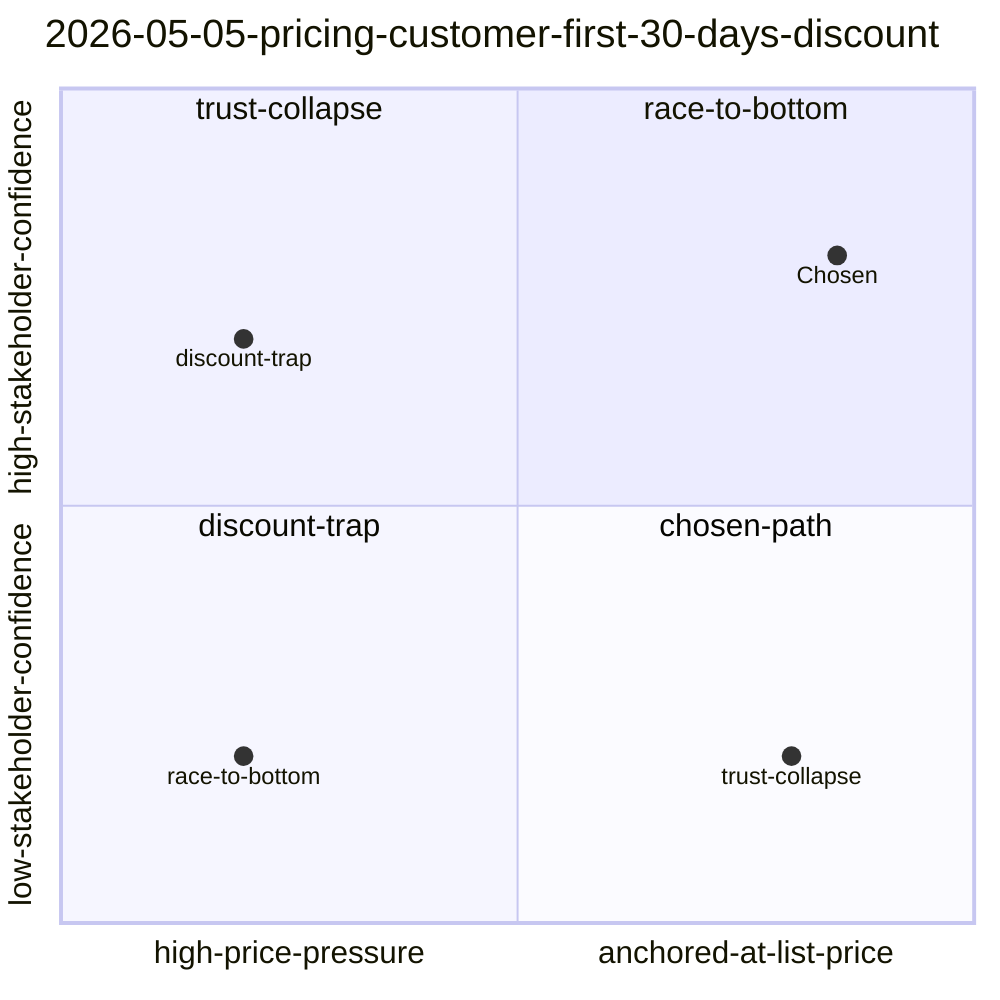

# counterfactual

Take a past decision in your decision wiki, enumerate forks at the moment-of-choice, simulate downstream consequences as resolvable conditionals, pressure-test under adversarial review, and append a counterfactual `reflection` entry the wiki can re-read forever.

The V1 thesis: counterfactuals are folders with predictions that resolve, not paragraphs of speculation. V1 builds the wiki entry. V3 instantiates folders. V4 grades the predictions on a schedule. Anything beyond writing the wiki entry is out of scope for this skill version.

## When to invoke this skill

- A wiki decision was logged with verdict `REVISE` and you want to know what the alternates look like
- A `GO` or `CUT` decision is more than 30 days old and new evidence has shifted the priors → invoke with `--force`
- The user types `/counterfactual <decision-id>`, asks "what if we'd gone the other way on X", "run a counterfactual on Y", "fork the pricing decision", "imagine we'd picked pgvector"
- A retrospective is needed before a related decision lands ("we're about to choose the same vendor again — what would the alt have looked like by now?")

## When NOT to invoke

- The decision is in-progress or unwritten — write it to the wiki first via `wiki-write`, then fork it
- The user wants forward-looking premortem on a not-yet-shipped decision — that is `--forward` mode in V3, defer for now
- The original entry has no `alternatives_considered:` field and the user won't fill one in — fork generation degrades to fuzzy keyword spelunking; refuse and ask to backfill or pass `--force`
- The verdict is `GO` or `CUT` and the entry is fresh (<30 days) — counterfactuals on those are entertainment, not learning. Require `--force` to override
- The user wants to actually *build* the alternate (worktree, plan, code) — that's V3 `--instantiate`. V1 only writes wiki entries
- The decision is trivial (renamed a variable, fixed a typo) — don't waste tokens forking it

If the cost of being wrong about the original decision is low, skip this skill.

## Hard caps (V1)

- **Default 4 forks** (Shell 2x2). Maximum 7 with `--depth=full` (Wachter near/medium/far + extras). No invocation produces 10+ forks.
- **50K token budget** per invocation. If a phase blows the budget, drop to a smaller fork count or skip Phase 4 grill.
- **REVISE verdicts only**, unless `--force` (then accept GO/CUT older than 30 days).
- **Writes one wiki entry.** No worktrees, no sidecar plans, no cron jobs, no instantiated folders. That is V3+.
- **Single grill pass**, not per-fork (Phase 4). Self-consistency sampling is V2.
- **No `terrain-focus-group`, no `graphify`** in V1. Both are V2.

## Invocation contract

```
/counterfactual <decision-id> [options]

Arguments:
  <decision-id>           Wiki entry ID (e.g., 2026-05-05-pricing-customer-first-30-days-discount)
                          OR a search query the skill resolves via wiki-query

Options:
  --method=<shell-2x2|wachter>     Fork enumeration method (default: shell-2x2)
  --depth=<lean|full>              lean=4 forks; full=7 (Wachter only) (default: lean)
  --force                          Allow GO/CUT decisions or fresh entries (default: REVISE-only)
  --emotional-fork                 Add an axis on the decision-maker's emotional state at decision time
  --no-grill                       Skip Phase 4 adversarial pressure (debugging only)
  --dry-run                        Generate but do not write to wiki
```

## Setup: where your wiki lives

Before using this skill, set the following in your environment or adapt the paths below to match your project's decision wiki:

```bash
WIKI_DIR=<your-wiki-dir>/decisions        # where decision entries live
WIKI_CF_DIR=<your-wiki-dir>/counterfactuals  # where counterfactual entries are written
WIKI_QUERY_SCRIPT=<your-wiki-dir>/_system/query.sh
WIKI_WRITE_SCRIPT=<your-wiki-dir>/_system/write-entry.sh
```

If you don't have a `query.sh` or `write-entry.sh`, adapt the steps below to use direct file reads and writes.

## Phase walkthrough

V1 runs phases 0, 1, 2, 4, 6, 7. Phases 3 (self-consistency) and 5 (instantiation) are skipped — they belong to V2 and V3. Phase numbers preserve the architecture doc so later versions slot in cleanly.

### Phase 0 — Decision archaeology

Recover the moment of choice. Read priors-at-time, never hindsight.

**Steps:**

1. Resolve the original entry. If the user passed an ID, locate the file directly:

   ```bash
   ls <your-wiki-dir>/decisions/<decision-id>.md
   ```

   Otherwise resolve from a query:

   ```bash
   bash <your-wiki-dir>/_system/query.sh "<decision summary or keywords>"
   ```

2. Read the entry's frontmatter and body in full. Pull out:
   - `id` (the canonical decision-id used downstream)
   - `verdict` (must be `REVISE`, or `--force` flag set)
   - `date` (drives the `+30/+60/+90` resolution targets)
   - `alternatives_considered:` (V1 substrate dependency — see "Failure modes" if missing)
   - `inputs:` (the priors-at-time graph)
   - `confidence`
   - `originSessionId` and `commit` (carried forward, not used in V1 logic)

3. Read every path in `inputs:`. These are the priors. Anything not in this set is hindsight and may not be used to generate forks.

4. (Optional but cheap) Pull scratchpad breadcrumbs from the same date:

   ```bash
   ~/.claude/scripts/scratchpad.sh --show --date <YYYY-MM-DD>
   ```

5. Verdict gate:
   - `verdict: REVISE` → proceed
   - `verdict: GO` or `CUT` and entry is older than 30 days → proceed
   - else if `--force` → proceed with a one-line warning in the body
   - else → halt with: `BLOCKED: counterfactual on fresh GO/CUT requires --force. Rerun with --force to override.`

### Phase 1 — Fork enumeration

Default is Shell 2x2. Wachter is the fallback when no clean two-axis split exists.

#### Shell 2x2 (default)

Identify the two highest-impact, highest-uncertainty variables that were live at decision time. Read the entry body — they're almost always named explicitly in the "Reasoning" or "Tradeoffs" section. If you can't find two clean axes after one read, fall through to Wachter.

For each axis, name a `low` and `high` value. Then populate four quadrants with internally consistent narratives. Each fork is a (low|high, low|high) intersection.

Use the `Skill` tool with `skill: "council"` to get framework lenses on each fork. Cap at 4 lenses. The council reads each fork and stress-tests internal consistency — not "is this a good idea" but "given these axis values, is the narrative coherent?"

**Output of this phase per fork:**

```yaml
- id: <slug>                          # kebab-case, derived from quadrant
  quadrant: <axis-1-value>, <axis-2-value>
  one_liner: <one sentence>
```

#### Wachter near/medium/far (fallback)

Trigger when:
- The user passes `--method=wachter`, OR
- The decision body does not surface two clean uncertainty axes after one read

Generate 3 forks (or up to 7 with `--depth=full`):
- **near** — exactly one variable changed from the chosen path. The "we were one step away from X" version.
- **medium** — a cluster of related variables changed. The "we made a different bet on the same question" version.
- **far** — the underlying premise inverted. The "we'd been a different organization" version.

`--depth=full` adds: 2nd near, 2nd medium, premise-inversion-with-stack-reality-check. Hard cap 7.

Output per fork:

```yaml
- id: <slug>
  distance: <near|medium|far>
  one_liner: <one sentence>
```

#### `--emotional-fork` (opt-in)

When set, add a third axis (Shell 2x2 → Shell 2x2x2 collapsed back to 4 forks by holding 1st axis dominant) or an extra near-fork (Wachter) on the decision-maker's emotional state at decision time: anxious vs confident, depleted vs fresh. Produces forks like "what if we'd made the same call with a clearer head?" Surfacing mood-as-mutable is sometimes the actual learning. Default off because it makes every run navel-gazing.

### Phase 2 — Single-pass simulation

For each fork, generate `predicted_consequences` as a YAML list of resolvable conditionals.

**A resolvable conditional must include:**
1. A verb-forward statement of what would have happened
2. A target date as offset from the original decision date (e.g., `+30 days`, `+60 days`, `+90 days`)
3. A resolution criterion — exactly how a future reviewer would check whether it came true

V1 is **single pass per fork**. No parallel sampling, no aggregation. (Self-consistency is V2.) Use the original entry's `inputs:` set as the *only* allowed evidence — no smuggling in hindsight.

**Output per fork:**

```yaml
predicted_consequences:
  - statement: <verb-forward sentence>
    by_date: <YYYY-MM-DD>            # = original_date + offset
    resolution_criterion: <how to check>
```

3-5 conditionals per fork is the sweet spot. More than 7 → trim; you're describing a screenplay, not a forecast.

### Phase 4 — Adversarial pressure (single grill pass)

Phase 3 (self-consistency confidence) is skipped in V1.

Use `Skill` with `skill: "grill"` **once** across all forks together. Pass the full set of forks (all `predicted_consequences`) and ask: "Which of these forks survive adversarial pressure? Which are weakened? Which are killed by reality / known constraints / documented decisions / known ground truths?"

Grill must consult any available ground-truth or constraint documents your project has established (e.g., pricing rules, architectural constraints, customer commitment records).

#### Grill framing rule (LOAD-BEARING — added after V1 dogfood)

This distinction is what makes counterfactuals validate decisions correctly. Without it, the skill always re-confirms the chosen path because every alternate fork's outcomes get killed by ground-truth tests, producing a circular loop that cannot strengthen-by-exploration.

**KILL forks whose causal mechanisms violate ground truths.**
- Example: a fork that says "we discounted pricing and customer retention IMPROVED" — the causal chain (low price → high retention) violates a documented anti-discount rule. The fork's mechanism is impossible. KILL.
- Example: a fork that says "the key stakeholder lost trust" when ground truth shows they publicly committed to the workflow and their credibility depends on it succeeding — the mechanism (trust collapse) is contradicted by documented commitment. KILL.

**PRESERVE forks whose predicted outcomes ARE the ground truth's predictions, even when the fork represents the rejected choice.**
- Example: a fork that says "we discounted and the buyer renegotiates at renewal, lifetime value drops 40-60%, reference customer reframes as price-sensitive." If the anti-discount rule LITERALLY PREDICTS these outcomes, the fork doesn't violate the rule — it instantiates the rule's predictions. PRESERVE.

**Rule of thumb:** ask "would the ground truth predict this outcome from this choice?"
- Yes → preserve (the fork validates the rejection; the rule is doing real protective work)
- No → kill (causal mechanism violates reality)

When this rule is applied correctly, rejected-choice forks can survive grill, which is what enables the convergent-counterfactual signal: surviving forks all point at the same conclusion as the chosen path, demonstrating that the rejection guarded a real failure mode rather than enforcing dogma.

**Update each fork with two new fields:**

```yaml
plausibility: <high|medium|low>
grill_verdict: <surviving|weakened|killed>
```

Skip this phase entirely if `--no-grill` is set (debugging only — every real run grills).

**Failure mode A — Grill kills all forks:** the original decision was load-bearing in a way you didn't realize. Don't panic-regenerate. Write the entry anyway with `grill_verdict: killed` on each fork and a body section titled `## What this means` explaining that the chosen path was robust against every plausible alternate the priors permitted. That's the convergent-counterfactual case — alt-timelines validate the original.

**Failure mode B — Grill preserves zero forks under the rule above:** if even rejected-choice forks (whose outcomes match ground-truth predictions) get killed, the grill applied the rule incorrectly. Re-run with explicit instruction to apply the framing rule above. A discount-trap-shaped fork whose outcomes match documented warnings is a canonical preserve-not-kill example — anchor it as a calibration point.

### Phase 6 — Visualization (mermaid quadrantChart inline)

Phase 5 (instantiation) is skipped in V1.

For Shell 2x2 forks, embed a mermaid quadrantChart in the entry body. Use this exact shape:

````markdown
```mermaid
quadrantChart
  title <decision-id>
  x-axis <axis-1-low> --> <axis-1-high>
  y-axis <axis-2-low> --> <axis-2-high>
  quadrant-1 <quadrant-1-name>
  quadrant-2 <quadrant-2-name>
  quadrant-3 <quadrant-3-name>
  quadrant-4 <quadrant-4-name>
  Chosen: [0.7, 0.7]
  Fork-A: [0.3, 0.3]
  Fork-B: [0.3, 0.7]
  Fork-C: [0.7, 0.3]
```
````

Position the chosen path at the quadrant that matches the actual decision. Position each fork at its quadrant.

For Wachter forks, skip mermaid and use a simple table instead:

```markdown
| distance | id | one_liner | plausibility | grill_verdict |
|---|---|---|---|---|
| near | ... | ... | high | surviving |
| medium | ... | ... | medium | weakened |
| far | ... | ... | low | killed |
```

### Phase 7 — Wiki write

Phase 7 always writes — except when `--dry-run` is set, in which case print the composed entry to stdout and exit.

Compose the counterfactual entry's frontmatter and body, then write to your wiki:

```bash
# If your wiki has a write-entry.sh script:
bash <your-wiki-dir>/_system/write-entry.sh reflection cf-<original-slug> <<'EOF'
<frontmatter body and content here>
EOF

# Otherwise write directly:
cat > <your-wiki-dir>/counterfactuals/<YYYY-MM-DD>-cf-<original-slug>.md <<'EOF'
<frontmatter body and content here>
EOF
```

The slug must be `cf-<original-slug>` so the file lands at `counterfactuals/<YYYY-MM-DD>-cf-<original-slug>.md`.

## Output schema (counterfactual entry)

The counterfactual entry uses `type: reflection` plus these fields specific to forking:

```yaml
---
# Standard wiki fields (auto-injected or required):
id: <YYYY-MM-DD>-cf-<original-slug>
type: reflection
date: <YYYY-MM-DD>
actors: [counterfactual, claude, council]
tags: [counterfactual, <original-domain-tag>, <fork-method>]
summary: >
  Counterfactual exploration of <original-id>. Method=<shell-2x2|wachter>.
  N forks generated; M survived grill. Top surviving fork: <id> (<one_liner>).
  Original decision <strengthened|weakened|orthogonal> by exploration.

# Counterfactual-specific:
forks_from: <original-decision-id>
fork_method: <shell-2x2|wachter-near-medium-far>
fork_axes:                                # Shell 2x2 only
  - axis: <name>
    low: <value>
    high: <value>
  - axis: <name>
    low: <value>
    high: <value>
forks:
  - id: <slug>
    quadrant: <e.g., "high-X, low-Y">     # Shell 2x2
    distance: <near|medium|far>            # Wachter
    one_liner: <description>
    predicted_consequences:
      - statement: <verb-forward>
        by_date: <YYYY-MM-DD>
        resolution_criterion: <how to check>
    plausibility: <high|medium|low>
    grill_verdict: <surviving|weakened|killed>
revisit_after: <YYYY-MM-DD>               # original_date + 90 days; written, not enforced in V1
status: active
---
```

The body sections are:

```markdown
# Counterfactual — <original-decision-title>

## Original decision
- **id:** <original-id>
- **verdict:** <GO|REVISE|CUT>
- **chosen path:** <one-liner of what was picked>
- **chosen because:** <reason>

## Method
<shell-2x2 or wachter, why this method, axes/distances chosen>

## Forks
<one section per fork with full predicted_consequences and grill verdict>

## Visualization
<mermaid quadrantChart for shell-2x2, table for wachter>

## Adversarial pressure
<grill summary — what survived, what got killed, why>

## What this means
<one-paragraph synthesis: did exploration strengthen, weaken, or leave the original decision orthogonal? If all forks were killed, this is the convergent-counterfactual case>

## Revisit
- `revisit_after: <YYYY-MM-DD>` — V4 cron will re-read this entry and grade predicted_consequences against actual events. V1 only writes the date.
```

## Anti-bloat rules

These are non-negotiable in V1. They exist because the architecture doc explicitly flags scope creep risk.

1. **No instantiation.** Never call `using-git-worktrees`, `/wtn`, `writing-plans`, or `executing-plans`. The skill writes one markdown file. Period.
2. **No scheduled review.** Don't register a cron, don't call `schedule`, don't create a launchd plist. `revisit_after:` is written to the entry but unenforced. V4 builds the resolver.
3. **No always-on agents.** No new dormant agent, no new event listener, no new Discord bot command, no new MCP server.
4. **No `terrain-focus-group`, no `graphify`, no `excalidraw-diagram`.** All V2.
5. **No self-consistency sampling.** Phase 3 is skipped. Single pass per fork.
6. **No fork count above 7.** Default 4. Max 7 (Wachter `--depth=full`). Anything that wants 10+ is wrong-shape; refuse.
7. **No 150K-token runs.** V1 budget is 50K. If you're spending more, you've drifted into V2/V3 territory — stop and trim.
8. **Counterfactuals are isolated from main retrieval.** They live in `<your-wiki-dir>/counterfactuals/`, not `decisions/`. Don't write into `decisions/`. Ever.

If a future feature wants any of the above, it ships in V2/V3/V4. Not here.

## Worked example — Pricing discount decision

The original entry is `2026-05-05-pricing-customer-first-30-days-discount.md`, verdict `CUT`. Because it's same-day-fresh and `CUT`, V1 requires `--force` to run.

```bash
/counterfactual 2026-05-05-pricing-customer-first-30-days-discount --force
```

### Phase 0 output

```
original_id: 2026-05-05-pricing-customer-first-30-days-discount
verdict: CUT
date: 2026-05-05
chosen path: Hold list price; offer value-add stack (annual founding-rate lock + extra seat + onboarding call)
priors:
  - DECISIONS-2026-05.md
  - pricing-recommendation.md (council lock, anti-discount policy)
  - ground-truths.md
  - project state doc
```

### Phase 1 output (Shell 2x2)

The two live uncertainties at decision time were:
- **Anchor-stability axis**: how much pricing pressure the buyer's finance team will apply over 12 months (low → high)
- **Trust-in-handoff axis**: how confident the key stakeholder is in the workflow at month 1 (low → high)

```yaml
fork_axes:
  - axis: anchor-stability
    low: high price pressure
    high: anchored at list price
  - axis: trust-in-handoff
    low: low stakeholder confidence
    high: high stakeholder confidence
forks:
  - id: chosen-path
    quadrant: high-anchor, high-trust
    one_liner: Value-add stack works; stakeholder confident; list price holds (chosen)
  - id: discount-trap
    quadrant: low-anchor, high-trust
    one_liner: 50% discount lands; stakeholder happy short-term; finance team renegotiates at renewal
  - id: trust-collapse
    quadrant: high-anchor, low-trust
    one_liner: List price holds but stakeholder doesn't trust the workflow; churn at month 2
  - id: race-to-bottom
    quadrant: low-anchor, low-trust
    one_liner: Discount AND trust collapse; reference account turns into a cautionary tale
```

### Phase 2 output (single-pass simulation, illustrative for `discount-trap`)

```yaml
predicted_consequences:
  - statement: Finance team references the discounted month-1 rate as the renewal anchor
    by_date: 2026-08-05
    resolution_criterion: Search meeting transcripts for any session where finance cites month-1 rate
  - statement: Stakeholder requests a second discount before month 6
    by_date: 2026-11-05
    resolution_criterion: Search comms for any "can we get the discounted rate again" pattern
  - statement: Acquisition narrative weakens — reference customer reads as price-sensitive
    by_date: 2026-11-05
    resolution_criterion: Compare next acquisition pitch deck reference-customer framing vs current
```

### Phase 4 output (single grill pass)

Grill kills `discount-trap` and `race-to-bottom` on the documented anti-discount rule. Weakens `trust-collapse` (key stakeholder is currently signaling high commitment). Leaves `chosen-path` standing.

```yaml
forks:
  - id: chosen-path
    plausibility: high
    grill_verdict: surviving
  - id: discount-trap
    plausibility: low
    grill_verdict: killed
  - id: trust-collapse
    plausibility: medium
    grill_verdict: weakened
  - id: race-to-bottom
    plausibility: low
    grill_verdict: killed
```

### Phase 6 visualization

````markdown

````

### Phase 7 write

```bash
bash <your-wiki-dir>/_system/write-entry.sh reflection cf-pricing-customer-first-30-days-discount <<'EOF'
actors: [counterfactual, claude, council]
tags: [counterfactual, pricing, anti-discount, shell-2x2]
summary: >
  Counterfactual exploration of the pricing discount decision. Shell 2x2 across
  anchor-stability and trust-in-handoff. 4 forks; 1 surviving (chosen path),
  2 killed by anti-discount rule, 1 weakened. Original decision
  strengthened — exploration produces convergent counterfactual against the
  CUT verdict.
forks_from: 2026-05-05-pricing-customer-first-30-days-discount
fork_method: shell-2x2
revisit_after: 2026-08-05
status: active
---

# Counterfactual — Pricing Discount Decision

## Original decision
...
EOF
```

Result file: `<your-wiki-dir>/counterfactuals/2026-05-05-cf-pricing-customer-first-30-days-discount.md`.

## Failure modes + escapes

### Original entry lacks `alternatives_considered:`, `inputs:`, or `confidence:` (substrate not backfilled)

The skill is built against the V1 schema extension. If the entry pre-dates the extension:

1. Print: `BLOCKED: original entry missing required fork-substrate fields: <list>. Backfill via wiki-write supersession or rerun with --force.`
2. If `--force`: degrade gracefully — extract `alternatives_considered` heuristically from prose body sections like `## Tradeoffs`, `## Counter`, `## Alternatives`, and use `## Citations` / `## Cross-References` as a stand-in for `inputs:`. Mark the resulting counterfactual entry with `degraded: true` in frontmatter so future readers know fork generation was prose-spelunked rather than graph-walked.
3. Never silently use hindsight evidence to fill the gap. The skill must reason from priors-at-time only.

### Grill kills all forks

This is the convergent-counterfactual case and it's a feature, not a failure. Write the entry with all forks marked `grill_verdict: killed`. The `## What this means` body section explicitly says: *"Every plausible alternate the priors permitted dies under adversarial pressure. The chosen decision was robust regardless of which fork we'd taken. This is a high-quality decision."*

Do not regenerate forks. Do not soften the grill. Convergence is the signal.

### No clean Shell 2x2 axes exist

If after one read of the decision body you cannot name two distinct, high-impact, high-uncertainty axes:

1. Switch to Wachter near/medium/far automatically (no `--method=wachter` required)
2. Note in the entry's `## Method` section: "Shell 2x2 attempted; no clean orthogonal axes; fell through to Wachter."
3. Do not force-fit two axes. A bad 2x2 is worse than a good 3-fork distance ladder.

### `query.sh` returns no match for the user's query

```
No matching wiki entries for: <query>
```

→ Print: `BLOCKED: no wiki entry matches "<query>". List candidates via 'ls <your-wiki-dir>/decisions/' or pass an explicit ID.`

Do not invent a decision and fork from it. The wiki is the source of truth.

### Token budget exceeded mid-run

If the running token count crosses 40K before Phase 7:

1. Drop the fork count: 4 → 3 → 2 (keep `chosen-path` + the most-likely surviving alt, drop others)
2. Trim each fork's `predicted_consequences` from 5 to 3
3. If still over budget, skip Phase 4 grill and write the entry with `grill_verdict: deferred-budget` on each fork. Mark the entry `status: partial` and add a `## Budget note` section.

Never silently truncate the body. The wiki must always show what's missing.

### `write-entry.sh` rejects the entry (validation failure)

The script will print which fields are missing or malformed. Common fixes:
- `summary:` exceeded 3 sentences → tighten
- duplicate `id` → bump slug, rerun
- `tags:` not kebab-case → fix
- `actors:` not a YAML list → fix

If your wiki doesn't have a `write-entry.sh`, write the file directly to `<your-wiki-dir>/counterfactuals/`.

## Composition map (skills V1 invokes)

| Phase | Skill / tool | Purpose |
|---|---|---|
| 0 | `wiki-query` (via `query.sh`) | Locate original entry from query |
| 0 | `Read` tool | Read entry frontmatter, body, every path in `inputs:` |
| 0 | `scratchpad --show` (optional) | Pull breadcrumbs from decision date |
| 1 | `Skill: council` | Framework lenses on each fork |
| 2 | inline LLM generation | Resolvable conditionals, single pass per fork |
| 4 | `Skill: grill` | Single adversarial pass across all forks |
| 6 | inline mermaid | quadrantChart for Shell 2x2; markdown table for Wachter |
| 7 | `wiki-write` (via `write-entry.sh`) | Append `reflection` entry to `counterfactuals/` |

Skills explicitly NOT invoked in V1: `terrain-focus-group`, `graphify`, `dispatching-parallel-agents`, `using-git-worktrees`, `/wtn`, `writing-plans`, `executing-plans`, `schedule`, `excalidraw-diagram`, `kickoff`. Those belong to V2/V3/V4.

## Read first

- `<your-wiki-dir>/synthesis/<date>-counterfactual-skill-architecture.md` — full architecture vision (7 phases, 5 mechanisms, build sequence) if you created one
- `<your-wiki-dir>/SCHEMA.md` — wiki frontmatter contract
- `~/.claude/skills/wiki-write/SKILL.md` — the writer this skill ultimately calls
- `~/.claude/skills/wiki-query/SKILL.md` — the resolver this skill uses to locate originals
- `~/.claude/skills/council/SKILL.md` — Phase 1 framework lenses
- `~/.claude/skills/grill/SKILL.md` — Phase 4 adversarial pass

## V1 acceptance gate

Running `/counterfactual <your-decision-id> --force` produces:

- 4 forks at the four quadrants of the chosen axes
- 3-5 resolvable conditionals per fork with explicit `by_date` and `resolution_criterion`
- single grill pass that kills implausible forks
- mermaid quadrantChart inline
- a `reflection` entry written to `<your-wiki-dir>/counterfactuals/<YYYY-MM-DD>-cf-<slug>.md`
- in <5 minutes wall time, <50K tokens

Anything beyond this output is V2+. Anything less is a bug.
